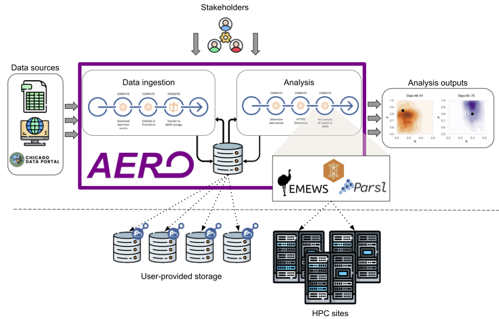

# Autonomous Event-based Research Orchestrator

AERO is the fabric that integrates distributed data and compute with event-based *triggers* to enable automated execution of scientific workflows. It is particularly useful to researchers who want to maintain ownership and control over their data and require access to high performance computing clusters to analyse the evolution of scientific phenomena. AERO provides the ability to connect different storage and compute through composable plugins, preserving a replayable local record of all flows that have been triggered and data that has been modified.

AERO itself is broken down into two components: a *server* and a *client* library. The server is responsible for connecting with data and storage providers, defining event triggers, maintaining replayable provenance records of all flow executions and exposing a REST API for client interactions. The client, on the other hand, is an API that serves facilitate interaction to the server REST API, allowing users to easily define flows and specify their input data and triggers.

## Installation

We provide dockerfiles to conveniently set up the server with Docker Compose

